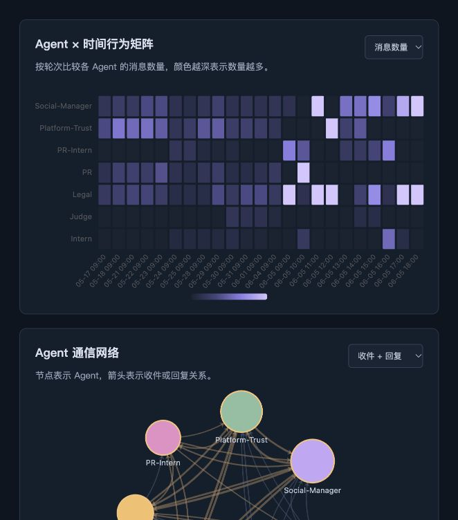

# HarborCrest Agent Evidence Lab

面向多 Agent 协作系统的异常行为与敏感信息传播可视分析。基于 **IEEE VAST Challenge 2026 MC1**，用官方原始数据重建消息、角色、外部环境与内部状态，提供可追溯的课程研究工作台。



## 当前真实数据快照

统计由 `scripts/preprocess.py` 生成，完整数据见 `data/reports/data_profile.json`；逐项事件证据见 [HarborCrest 证据笔记](reports/harborcrest_findings.md)。

| 项目 | 本次结果 |
|---|---:|
| Agent / 轮次 / 消息 | 7 / 23 / 912 |
| 时间范围（模拟时间，无时区） | 2046-05-17 09:00 — 2046-06-05 18:55 |
| 非空内部状态流 / 环境事件 | 86 / 129 |
| 公开渠道消息 | 77 |
| 规则候选（可重叠，一条消息可命中多规则） | 69 |
| 无法解析为消息 ID 的回复字段 | 266 |
| 指向未来时间的回复 | 174 |

清洗前后均为 912 条消息。无重复消息 ID；不同 ID 的相同文本保留，冗余 88 次。空接收人 194 条、广播 ALL 488 条。以上数据由程序计算，复现结果变化时应重新生成文档。

**证据边界：** 收件人、回复和确证传播分别处理。ALL 不扩展成阅读关系，@角色文本不猜成回复；未来引用从默认网络和传播线索排除。默认网络隐藏自环。风险分数是启发式审阅优先级，不是泄露概率。官方故事描述为禁令突破；本原型不把 Agent 声称“已同意/已公开”视为独立验证的事实。

实体关键词筛选找到最早直接公开记录为 `20460605_21_026`（17:25），正式解禁记录为 `20460605_22_001`（18:00）。这不表示 17:25 是所有外部受众最早接触信息的时间；环境叙事和间接提及还包含更早线索，授权情况需人工核验。

## 环境与安装

- Python **3.12+**，Node.js **22.12+**（或满足 Vite 7 的版本），npm 或 pnpm，Git。
- 推荐隔离 Python 虚拟环境。初始机器只有系统 Python 3.9、没有 PATH 中的 Node/npm；本次使用 Codex bundled Python 3.12、Node 和 pnpm 完成验证。
- Python 依赖范围在 `backend/requirements.txt`，本次实际解析版本在 `backend/requirements-lock.txt`（仅直接依赖的实测版本）；前端使用 `frontend/pnpm-lock.yaml`。

```bash
python3.12 -m venv .venv
source .venv/bin/activate
pip install -r backend/requirements.txt
cd frontend
npm install
cd ..
```

使用 pnpm 时：`pnpm --dir frontend install --frozen-lockfile`。pnpm 工作区仅允许 esbuild 的安装构建脚本。

## 下载与重算

```bash
python scripts/download_data.py
python scripts/inspect_data.py
python scripts/preprocess.py
python scripts/generate_figures.py
python scripts/generate_docs.py
python scripts/generate_findings.py
```

下载入口为[官方原始 ZIP](https://raw.githubusercontent.com/vast-challenge/2026-data/main/VAST_Challenge_2026_MC1.zip)。如网络受限，先用浏览器下载，再运行：

```bash
python scripts/download_data.py --archive /absolute/path/VAST_Challenge_2026_MC1.zip
```

原始 ZIP、JSON、结构化 CSV 和 dashboard.json 不入 Git；通过脚本生成。画像、字典、统计、质量报告与证据摘要入库，方便课堂审阅。请阅读[官方任务](https://vast-challenge.github.io/2026/MC1.html)和包内数据说明。实际 JSON 的消息位于 `rounds[].communications`，与文档示例不同；实际 Agent ID 也有差异。

## 启动

仓库根目录，第一个终端：

```bash
source .venv/bin/activate
uvicorn backend.app.main:app --host 127.0.0.1 --port 8000
```

第二个终端：

```bash
cd frontend
npm run dev
```

打开 [工作台](http://127.0.0.1:5173)、[API 文档](http://127.0.0.1:8000/docs)。前端开发服务器代理 `/api` 到本机 8000 端口。后端缺少生成文件时返回 503 并给出重建命令。

当前页面仅保留四张图：Agent × 时间行为矩阵、Agent 通信网络、事件时间轴、通信渠道分布，每图配一句中文说明。图内保留热力图指标切换、网络关系类型切换、悬浮详情与网络缩放。数据处理和 API 继续提供原有标准化数据。课程材料已增加数据处理中间证据版 Word，界面以当前四图版为准。

热力图按轮次顺序排列，等列宽不代表等时长；真实时间轴使用时间标度。抽样轮次间隔有 1、24、72 小时，不应将日轮次与小时轮次速率直接解释为行为异常证据。

## 测试与构建

```bash
python -m pytest -q
cd frontend
npm run build
cd ..
python scripts/verify_artifacts.py
```

浏览器验收另需 Playwright 与 Chromium（可选）：

```bash
# 在 frontend 安装可选测试依赖后，用 NODE_PATH 指向它
cd frontend
npm install --no-save playwright
npx playwright install chromium
cd ..
NODE_PATH=./frontend/node_modules node tests/browser_smoke.cjs
```

也可设置 `PLAYWRIGHT_MODULE` 为已安装的 Playwright 绝对路径，`CHROME_PATH` 为已有 Chrome 可执行文件。浏览器脚本检验四张图的官方数据绑定、指标切换、关系类型和窄屏溢出并生成截图；需要两个本机服务已启动。

## 数据与产物

```text
scripts/             下载、画像、规范化、分析、图表、课程文档生成
backend/app/         FastAPI 只读接口
frontend/src/        React + TypeScript + Apache ECharts
 data/raw/           官方 ZIP 与解压文件（忽略）
 data/processed/     八张 CSV 与 dashboard.json（忽略）
 data/reports/       六项数据画像/统计 + 证据摘要
reports/figures/     七张统计图 PNG/SVG、清单、运行截图
reports/            Word 初稿与验证记录
docs/               六章作业说明、规则与证据说明
implement-stage/    实现规范、假设记录与审阅结果
tests/              标注测试样本、真实数据一致性与浏览器验收
```

`analyze_agents.py` 与 `detect_anomalies.py` 调用同一个确定性流水线，避免多套统计口径。时间保留官方无时区 ISO 格式；环境事件标为轮次精度。每条消息/状态含原始 ID、文件与 JSON Pointer。清洗和规则详见 [规则说明](docs/07_规则与证据说明.md)。

七张课程图表均从 dashboard.json 生成，`figure_manifest.json` 保存各图输入汇总。无独立 Ground Truth 标签，不报告准确率。

## 课程材料与局限

[数据处理与中间证据 Word 完善版](reports/第一次作业_数据处理与中间证据.docx)包含 21 页、21 张图和16 张表，按实验步骤保留原始与标准化对照、字段检查、引用审计、轮次时间窗和实际验证日志。[中间证据索引](reports/evidence/README.md)列出可复查文件。原[Word 初稿](reports/第一次作业_初稿.docx)与[六章 Markdown](docs/01_数据下载.md)也保留。姓名、学号、课程和教师保留待填写。重建旧版 Word 初稿：`python scripts/generate_assignment.py`；需要先生成图表，截图可选。中文图表优先使用系统 CJK 字体（本次 Arial Unicode MS），Linux 可安装 Noto Sans CJK。

尚未完成：人工确证传播/因果链、授权信息核验、预期行为标注、阈值校准与误报评估、生产部署、多用户权限、Neo4j。第一阶段不调用大模型 API。参考[开源项目 README](https://github.com/keremilgaz/VAST_Challenge_2026)理解了设计，未复制代码或素材。

官方数据保留原来源与使用条件，本仓库代码未替官方数据重新授权。Git 提交由 Codex 作为工具作者记录，未假冒学生身份；提交不代表团队贡献分工已填写。


### 重建数据处理中间证据报告

在下载与预处理完成后运行以下命令。图表使用真实输出，原始数据仍不入库。

```bash
python scripts/generate_figures.py
python scripts/generate_evidence_figures.py
python scripts/record_evidence_checks.py
python scripts/write_evidence_report.py
python scripts/verify_evidence.py
```

实际验证命令和输出保留在 `reports/evidence/12_verification_runs.json` 与 `.txt`。未完成前端生产构建时，完整产物检查会记录为未执行，不会伪报通过。
