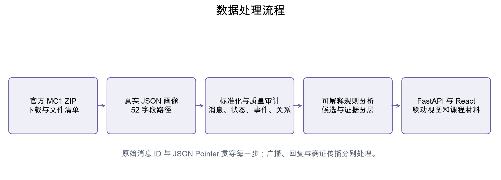

# 数据下载

## 目标

取得可追溯的官方数据，建立可重新执行的获取入口。

## 实际操作

从官方 raw.githubusercontent.com 地址下载 VAST_Challenge_2026_MC1.zip，解压并读取全部语义文件。数据说明与 Answer Sheet HTML 均已检查。macOS 资源叉和 .DS_Store 只计入文件清单。

## 实现方法

运行 python scripts/download_data.py；离线时用 --archive 指向官方 ZIP。下载使用临时文件并验证 ZIP 格式，解压前检查路径不能越出 data/raw。官方 main 分支为下载来源，版本变化后须重新审阅 schema。

## 主要结果

ZIP 内有 7 个文件条目（不含目录），其中 3 个语义文件：MC1_final_00.json 987742 字节、mc1 data description.md 5699 字节、Answer Sheet.htm 83347 字节。官方数据共 912 条消息。当前文件清单和字节数由 data_profile.json 自动生成；本段是此次快照的核对结果。

## 分析结论

[官方任务说明](https://vast-challenge.github.io/2026/MC1.html)、[官方数据仓库](https://github.com/vast-challenge/2026-data)。参考项目仅阅读 [README](https://github.com/keremilgaz/VAST_Challenge_2026)，未复制其代码、图像或分析结论。 原始数据和 ZIP 均不入 Git，画像、图表与代码可公开审阅。

## 后续改进空间

当前官方入口使用 main；后续在课程报告中登记课程采用的数据版本，并保留离线压缩包。

## 真实图表

