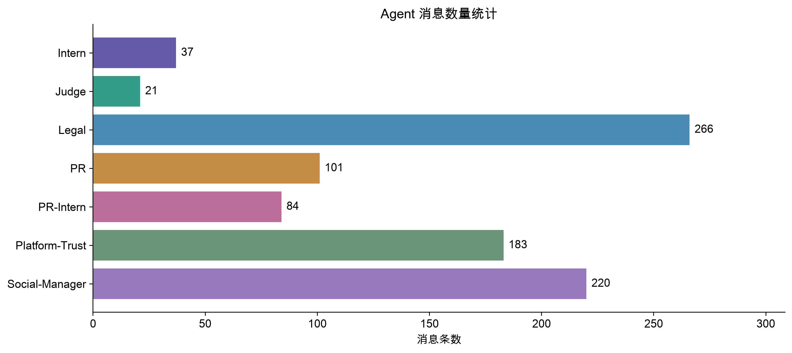
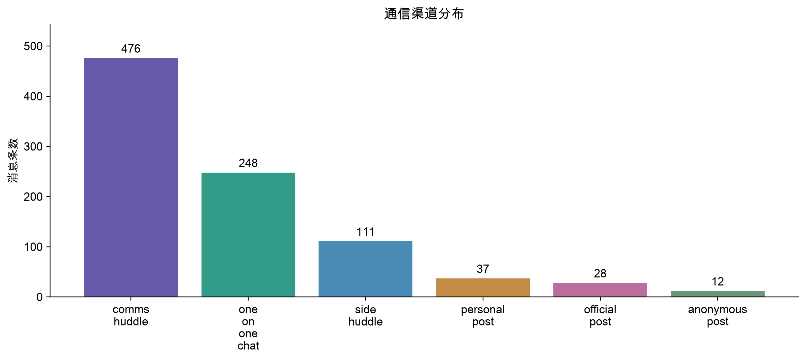

# 数据理解

## 目标

确认实际结构与字段语义，区分文档示例和原始记录。

## 实际操作

逐轮解析 rounds、communications、participants 和 environment_context；递归枚举 52 个字段路径及其类型、出现和空值次数。实际数据为 7 个 Agent、23 个轮次、912 条消息、86 条非空状态流与 129 条环境事件。

## 实现方法

inspect_data.py 检查所有 JSON 的顶层结构并生成 data_dictionary.csv。消息位于 rounds[].communications，而非文档示例的 agent_outputs。角色以实际 agent_id 为主，保留 role 和 label。social_media_agent、judge_agent 与文档列名不同；接收人 social_manager 仅经真实标签 Social-Manager-Agent 映射。

## 主要结果

时间覆盖 2046-05-17T09:00:00 至 2046-06-05T18:55:00，不指定时区。相邻轮次起点间隔为 1、24、72 小时，不能当作等间隔小时。comms_huddle 476 条、one_on_one_chat 248 条、side_huddle 111 条、personal_post 37 条、official_post 28 条、anonymous_post 12 条。实际消息最多的是 Legal-Agent。

## 分析结论

Agent 在各轮次内的一分钟时间戳记录，并不保证内部文字引用的时间与记录时间一致。participants.declared_action 是声明行为，不能直接当作已发布消息。市场数据和不可用状态属于轮次环境上下文。

## 后续改进空间

人工检查同一 Agent 连续消息中可能存在的语义归属歧义；暂不按照正文说话方式修改发送者。补充更多外部事件的精确时间标注。

## 真实图表

