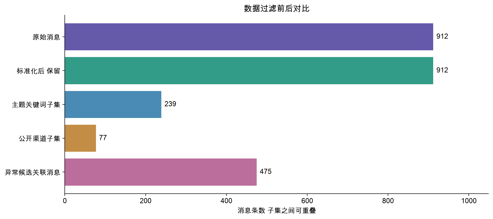

# 数据过滤

## 目标

减少分析噪声并保留审计证据，避免把字段不完整等同于无行为。

## 实际操作

清洗前后均为 912 条消息；完全重复 ID 删除 0 条，排除记录 0 条。没有缺失的必需字段。internal_state 为空 826 条，responding_to 为空 163 条；空接收人 194 条；不同 ID 的相同正文冗余 88 次均保留。

## 实现方法

只在分析视图中过滤时间、Agent、渠道、关键词；CSV 保留原 ID、来源文件和 JSON Pointer。广播 ALL 不展开成阅读事件；空接收人不补猜。回复字段中的 @文本不能解析为消息 ID，按无效引用报告；未来回复边保留 temporal_valid=false，默认网络和传播线索均排除。

## 主要结果

无效回复引用 266 条，未来回复引用 174 条。主题关键词消息 239 条，公开渠道 77 条，异常候选关联消息 475 条。子集互有重叠，不是逐层删除。

## 分析结论

关键词只产生审阅入口。网络中的收件人和回复方向分别标记，不能自动解释成敏感信息已传播；未来引用尤其不应构成时间因果链。

## 后续改进空间

加入人工标注的同义表达、否定表达及权限级别，评估关键词筛选的误报和漏报，不盲目扩大正则。

## 真实图表

