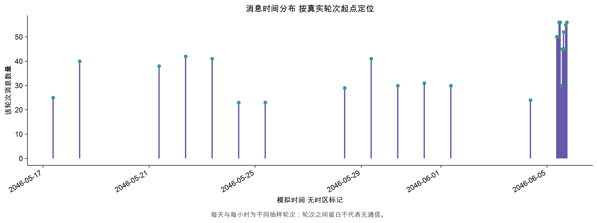

# 数据处理

## 目标

将嵌套原始记录转为可复算的数据表，并产出有来源的统计与候选。

## 实际操作

建立 messages、agents、events、internal_states、communication_edges、participants、rounds、candidates 八张 CSV，输出 API 共用 dashboard.json。画像和统计位于 data/reports。

## 实现方法

总体速率统一采用全语料窗口总时长作分母。整轮速率候选关联该Agent该轮全部支持消息，首条只用于定位；候选在任一支持消息通过筛选时显示。轮次窗口按下轮起点计算，末轮以最后消息时间计算且至少一分钟；速率是样本轮次消息数除以窗口小时数，不能解释成连续监测的真实事件率。通道名 trim/lower，角色通过无歧义 ID/role/label 规范化。重复 ID 内容冲突直接失败，不悄悄覆盖。

## 主要结果

共 898 条关系记录，其中时间有效 724 条（含自回复）；默认网络进一步隐藏自环。规则产生 69 条候选，涵盖速率跃升、首次公开渠道、实体公开与人员不可用时的主题决策。

## 分析结论

首个实体公开消息 20460605_21_026 在 2046-06-05T17:25:00，发送者 legal_agent。明确正式解禁记录 20460605_22_001 在 2046-06-05T18:00:00。早于正式标记的公开不自动证明未经同意；17 时轮次存在 Legal 对双边同意的声称，必须并列阅读。

## 后续改进空间

阈值需要人工标注评估。不同抽样粒度造成的速率变动会触发规则，所以候选需要结合真实时间窗口判断。后续区分首次披露、转述、推测和重复发布。

## 真实图表

