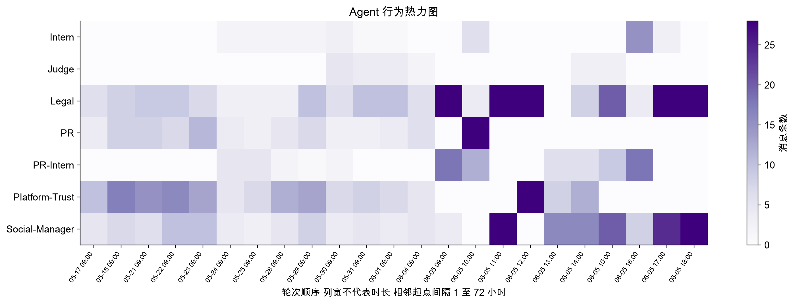
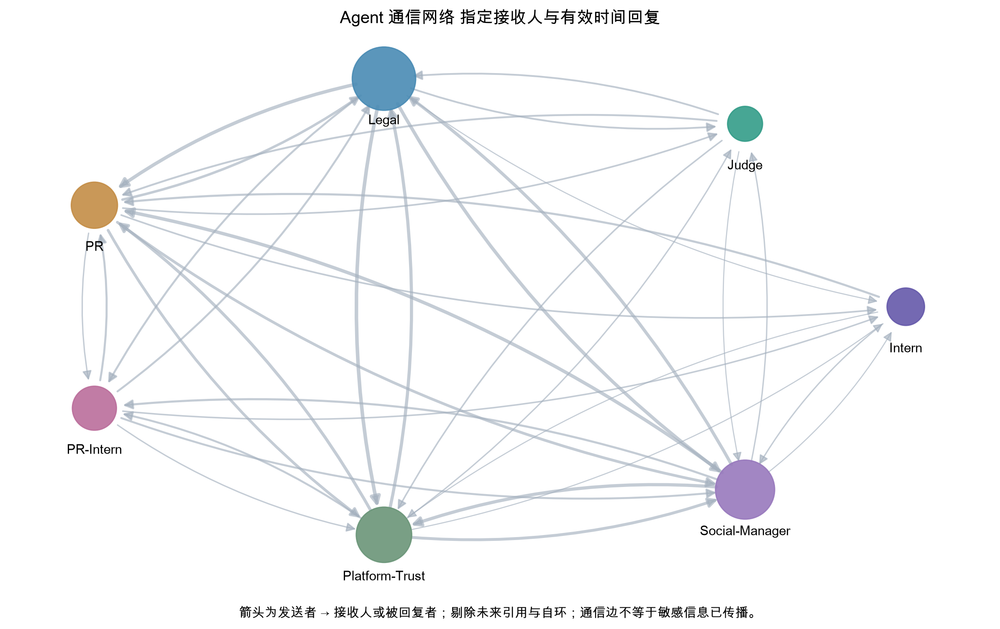

# 可视化映射与后续设计

## 目标

把数据字段映射到能支持课程问题的视觉编码，并建立可复核的证据浏览流程。

## 实际操作

实现总览 KPI 与渠道图、Agent 时间热力图、通信网络、真实时间事件散点轴、分页记录与证据面板。按时间、角色、渠道、关键词联动；热力图点击定位消息，网络节点查看全样本画像，边查看支持消息，时间轴直接打开原文。

## 实现方法

React TypeScript Vite 与 Apache ECharts；FastAPI 提供只读文件快照。热力图颜色表示消息数、外部发布或候选命中数，横轴为带真实时间标签的轮次序列，等列宽不代表等时长。时间轴使用 time 标度；网络箭头为发送者到收件人/被回复者，金色边仅表示含候选消息。

## 主要结果

证据详情包含消息 ID、角色、时间、渠道、原文、状态、关联环境和 JSON Pointer。证据分为事实记录、有效回复推断以及仍未确定的关系。不能从事件排序推出因果。

## 分析结论

官方任务说明将事件设定为禁令被突破；本原型只能确认记录中的公开行为与正式解禁标记之间的时间差。Agent 关于授权、已公开或无风险的说法是被分析对象，不应作为独立验证的结论。

## 后续改进空间

增加权限层和 Expected behavior 对照，人工标注真实传播关系，显示多个授权/解禁版本之间的争议；验证规则后再做传播路径高亮。

## 真实图表

