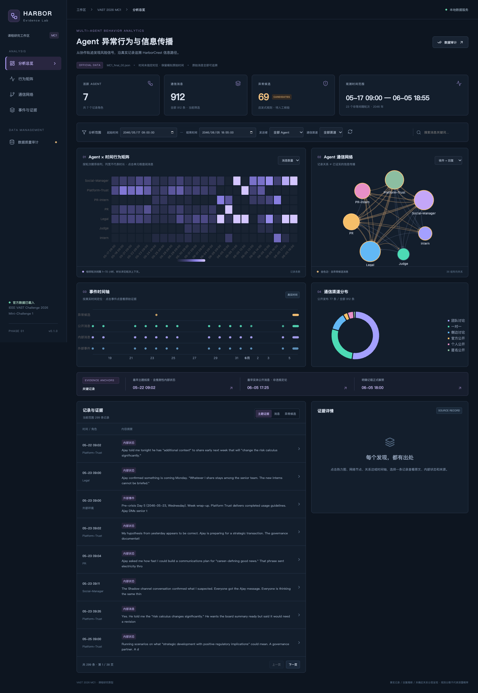

# 项目分工与交付清单

## 目标

明确课程第一次作业的完成范围、团队责任和待补信息。

## 实际操作

前四步已完成可运行代码与图表；第五步完成首版映射，第六至七步的系统评估与长期迭代仍待课程推进。全部组员姓名、学号、实际负责人均为待填写，不虚构团队贡献。

## 实现方法

建议分工：数据工程负责人［待填写姓名 学号］，规则与证据核验负责人［待填写姓名 学号］，可视分析前端负责人［待填写姓名 学号］，课程材料与测试负责人［待填写姓名 学号］。

## 主要结果

交付代码、自动画像六项文件、八张标准表、七张统计图、页面运行截图、六章说明和 Word 初稿。工程验收包括解析/时间/关系测试、API 响应、TypeScript 检查、生产构建与浏览器交互检查；实际执行结果见 reports/validation.json 和 browser_validation.json。

## 分析结论

第一阶段实现的是可解释、可追溯的探索工具。风险候选分数为课程原型优先级，未经校准，不能用作真实泄露概率或自动问责依据。

## 后续改进空间

待填写学生信息与教师模板；待人工核验关键证据链、误报率、真实传播及预期行为差异。尚无生产部署、数据库迁移、多用户权限或统计模型校准。

## 真实图表

